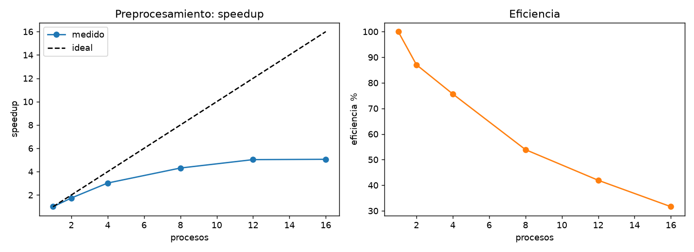
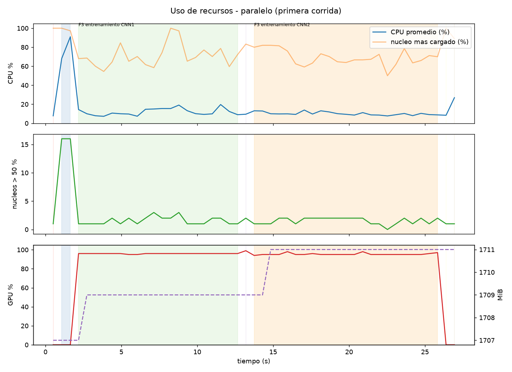
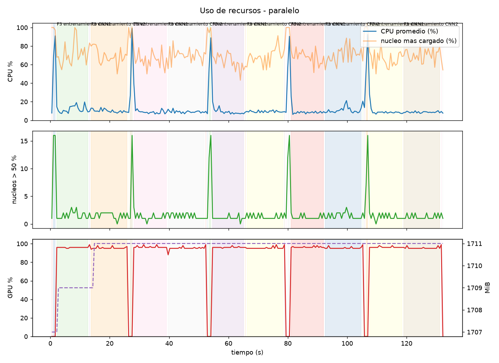
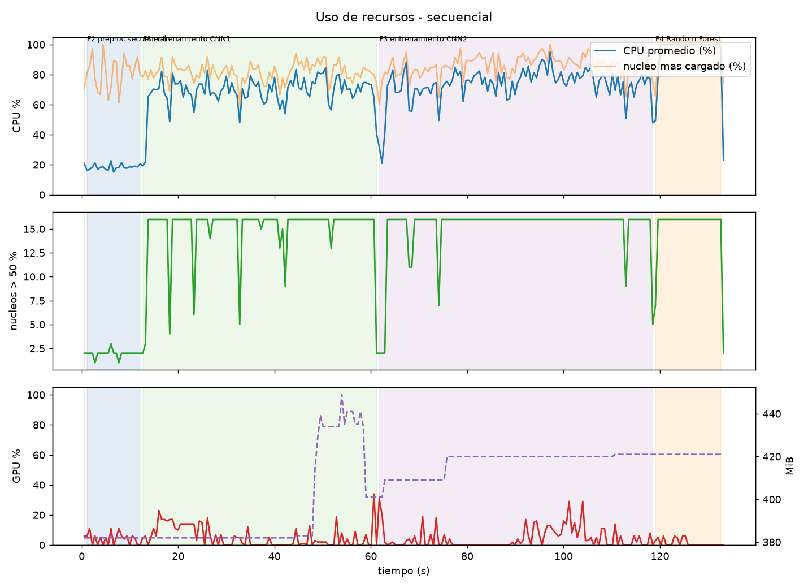
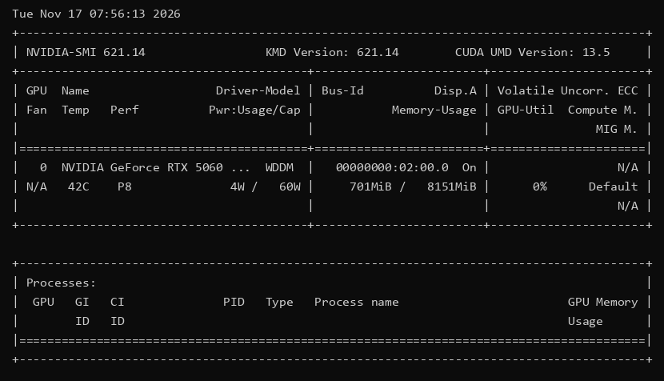
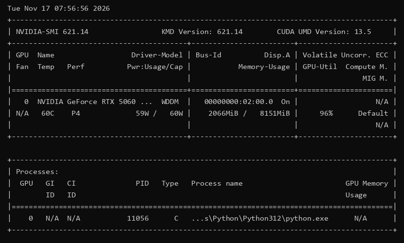
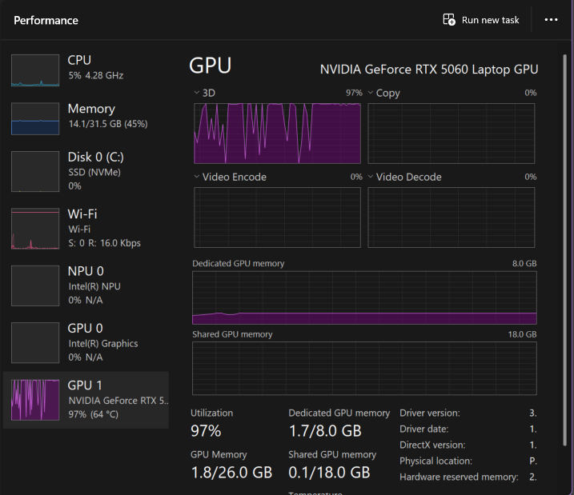
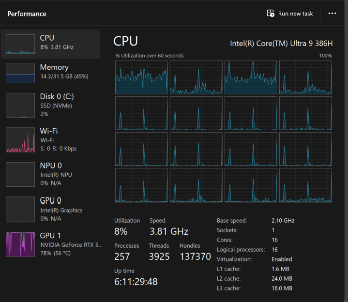
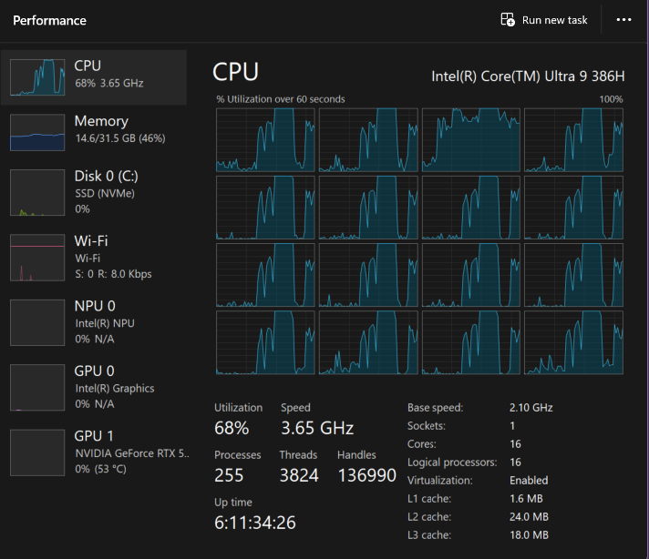

# 5. Implementación con CUDA Python

## 5.1 Qué se implementó

| Archivo | Contenido |
|---|---|
| `common/prep.py`, `common/prep_worker.py` | Listado/split/submuestreo (igual al notebook) y preprocesamiento paralelo por bloques con `ProcessPoolExecutor`. Devuelve `uint8`. |
| `gpu/kernels_cuda.py` | **Kernels CUDA propios en Numba CUDA** (`@cuda.jit`): normalización, convolución 3×3 + ReLU, max-pool, capa densa (GEMM por teselas), argmax, y sus lanzadores que fijan grid y bloque. |
| `gpu/forward_cuda.py` | Propagación hacia adelante de CNN 1 y CNN 2 usando **solo** los kernels propios. |
| `gpu/models_torch.py` | CNN 1 y CNN 2 en PyTorch (misma arquitectura y mismo número de parámetros que el notebook Keras) y el bucle de entrenamiento. |
| `gpu/benchmark_gpu.py` | Benchmark del pipeline paralelo (`--device cuda`) y de PyTorch en CPU como referencia (`--device cpu`). |
| `gpu/benchmark_prep_scaling.py` | Escalamiento del preprocesamiento con 1…16 procesos. |
| `common/monitor.py`, `common/plot_monitor.py` | Registro de uso de CPU por núcleo y de GPU (`nvidia-smi`) con marcas por fase, y sus gráficas. |
| `docs/generar_figuras_y_tablas.py` | Genera `docs/tablas_comparacion.md` y las figuras de `docs/figuras/` a partir de los CSV. |

### Librerías y funciones que habilitan el uso de la GPU

| Librería | Papel |
|---|---|
| **PyTorch 2.11 (CUDA 12.8)** | Tensores en GPU, autograd (retropropagación), optimizador Adam, `torch.randperm` en GPU. Usa **cuDNN** para convoluciones y **cuBLAS** para multiplicaciones de matrices. |
| **Numba CUDA** (`numba-cuda`) | Escribir kernels en Python (`@cuda.jit`), memoria compartida (`cuda.shared.array`), `cuda.syncthreads()`, lanzamiento con `kernel[grid, block](...)`. Compila a PTX con NVRTC/NVVM. |
| **`__cuda_array_interface__`** | Protocolo que permite a Numba usar tensores de PyTorch directamente en GPU, sin copiarlos. |
| **cuda-bindings / `nvidia-cuda-*-cu12`** | Controlador y compilador de CUDA 12.8 (necesario para la arquitectura Blackwell de la RTX 5060, *compute capability* 12.0). |
| `torch.cuda.synchronize()` | Sincronización antes y después de cada fase para medir bien (los lanzamientos de kernels son asíncronos). |
| `concurrent.futures.ProcessPoolExecutor`, Pillow | Paralelismo en CPU para decodificar y redimensionar imágenes. |
| `psutil`, `nvidia-smi` | Monitoreo de CPU por núcleo y de GPU. |

## 5.2 Entorno

| Elemento | Valor |
|---|---|
| GPU | NVIDIA GeForce RTX 5060 Laptop, 8 GB, *compute capability* 12.0, controlador 621.14 |
| CUDA (PyTorch) | 12.8 |
| CPU | 16 hilos lógicos |
| Python | 3.12.8 (entorno `uv`) |

Cambios al entorno (`pyproject.toml`): se añadieron `torch` (índice `cu128`), `numba-cuda[cu12]`, `cuda-bindings>=12.9.8` y `psutil`. **NumPy se fijó en `>=2.3,<2.4`** porque `numba-cuda` 0.30.4 no es compatible con NumPy 2.5 (usa `np.row_stack`, eliminada).

Reproducir: `uv sync` y luego
```
uv run python gpu/benchmark_gpu.py --device cuda --runs 5 --epochs 10 --monitor gpu/resultados/monitor_gpu.csv
uv run python gpu/benchmark_gpu.py --device cpu  --runs 3 --epochs 10
uv run python gpu/benchmark_prep_scaling.py
uv run python docs/generar_figuras_y_tablas.py
```

## 5.3 Condiciones de la medición (idénticas al secuencial)

- Mismos datos: 12,180 imágenes de entrenamiento y 2,610 de validación (mismo split, `SEED=42`).
- Mismas arquitecturas (CNN 1 y CNN 2), lote 32, Adam (lr 1e-3, ε 1e-7), inicialización Glorot uniforme, **10 épocas fijas**, validación al final de cada época.
- 1 corrida de calentamiento descartada (inicialización de CUDA, autotuning de cuDNN, compilación JIT de los kernels de Numba) y **5 corridas medidas**.
- Cada fase se mide con `time.perf_counter()` y `torch.cuda.synchronize()`.
- **La transferencia CPU→GPU está incluida** (`T1`), junto con la normalización en GPU (`N`). El tiempo del pool de procesos (su arranque) está incluido en F2.
- Precisión: `float32`. Las convoluciones de cuDNN pueden usar TF32 en las GPU recientes (valor por defecto de PyTorch), lo que explica que los *logits* de los kernels propios difieran ≈ 2×10⁻⁴ de los de PyTorch.
- Se midió además **PyTorch en CPU** (3 corridas) para separar el efecto del *framework* del efecto de la GPU.

## 5.4 Verificación de corrección

| Prueba | Resultado |
|---|---|
| Normalización (kernel propio) vs `x.float()/255` de PyTorch | Diferencia máxima 6×10⁻⁸ (1 ulp) |
| *Logits* de CNN 1 y CNN 2 (kernels propios) vs PyTorch, entradas aleatorias | Diferencia máxima ≈ 2×10⁻⁴; clase predicha idéntica en el 100 % de las muestras |
| Accuracy en validación de modelos entrenados, kernels propios vs PyTorch | **Idéntica en las 5 corridas** (p. ej. CNN 2: 0.9701 en ambos) |

## 5.5 Resultados medidos (5 corridas, segundos)

Datos crudos: `gpu/resultados/gpu_tiempos.csv`, `gpu_resumen.csv`, `gpu_log.txt`.

| Corrida | F1 | F2 preproc. (train+val) | T1+N transfer. + normalización | CNN 1 (10 ép.) | CNN 2 (10 ép.) | Inferencia PyTorch (CNN 1+2) | Inferencia kernels propios (CNN 1+2) |
|---|---|---|---|---|---|---|---|
| 1 | 0.67 | 0.99 | 0.018 | 11.27 | 12.65 | 0.196 | 0.361 |
| 2 | 0.59 | 1.01 | 0.019 | 11.32 | 12.78 | 0.195 | 0.362 |
| 3 | 0.61 | 0.99 | 0.019 | 11.44 | 12.79 | 0.196 | 0.363 |
| 4 | 0.62 | 0.98 | 0.024 | 11.38 | 12.78 | 0.195 | 0.362 |
| 5 | 0.63 | 0.99 | 0.019 | 11.45 | 12.81 | 0.196 | 0.363 |

La dispersión entre corridas es muy pequeña (desviación del total: 0.12 s). Tiempo por época: CNN 1 ≈ 1.14 s y CNN 2 ≈ 1.28 s (en el secuencial: 3.89 s y 4.59 s).

### Escalamiento del preprocesamiento (CPU)

Preprocesar las 14,790 imágenes (train + val), 5 repeticiones, **incluido el arranque del pool**.

| Procesos | Tiempo (s) | Speedup | Eficiencia |
|---|---|---|---|
| 1 (sin pool) | 5.04 ± 0.02 | 1.00× | 100 % |
| 2 | 2.89 ± 0.02 | 1.74× | 87 % |
| 4 | 1.67 ± 0.02 | 3.03× | 76 % |
| 8 | 1.17 ± 0.00 | 4.31× | 54 % |
| 12 | 1.00 ± 0.01 | 5.03× | 42 % |
| 16 | 1.00 ± 0.02 | 5.06× | 32 % |



La ganancia se satura en ≈ 5× a partir de 12 procesos: el arranque de procesos, la lectura de disco y la mezcla de núcleos de rendimiento y de eficiencia de este portátil limitan la escalabilidad.

## 5.6 Evidencia de uso de recursos

Capturado con `common/monitor.py` (muestreo cada 0.5 s). Las tablas completas están en `docs/tablas_comparacion.md`.

**Paralelo (CPU multiproceso + GPU)**

| Fase | CPU prom. % | Núcleos >50 % | GPU util. prom. % | GPU util. máx. % |
|---|---|---|---|---|
| F1 listado + split | 9 | 1.0 | 0 | 0 |
| **F2 preprocesamiento (CPU)** | **72** | **12.8** | 0 | 0 |
| **F3 entrenamiento CNN 1 (GPU)** | 10 | 1.3 | **96** | 99 |
| **F3 entrenamiento CNN 2 (GPU)** | 10 | 1.4 | **95** | 99 |
| F5 inferencia | 9–12 | 1.5–1.8 | 98–99 | 99 |





**Secuencial (TensorFlow en CPU)**

| Fase | CPU prom. % | Núcleos >50 % | GPU util. prom. % |
|---|---|---|---|
| F2 preprocesamiento (un proceso) | 18 | 2.0 | 4 |
| F3 entrenamiento CNN 1 | 69 | 15.0 | 5 |
| F3 entrenamiento CNN 2 | 74 | 15.2 | 5 |
| F4 Random Forest | 97 | 15.6 | 1 |



Lectura de la evidencia:
- En el preprocesamiento paralelo, 12.8 de 16 núcleos superan el 50 % de uso, frente a 2 en el secuencial (un núcleo para Python más el sistema).
- En el entrenamiento paralelo la **GPU está saturada (95–99 % de utilización)** y el CPU casi ocioso (≈ 10 %, un hilo de Python que lanza kernels). En el secuencial el CPU trabaja en 15 de 16 núcleos y la GPU permanece prácticamente sin uso.
- La utilización de GPU de 4–6 % en el secuencial corresponde al escritorio de Windows, no a TensorFlow (que no ve la GPU).
- Los picos del CPU en las gráficas del paralelo son los arranques del pool de procesos de cada corrida.

**Salida de `nvidia-smi`**

Se ejecutó `nvidia-smi` cada 2 s durante una corrida del pipeline paralelo. Primero, la GPU en reposo (antes de iniciar); después, una muestra durante el entrenamiento de CNN 1: 96 % de utilización, 2,066 MiB de memoria y 59 W de 60 W de consumo. En la tabla de procesos se omitieron las aplicaciones ajenas al proyecto.





**Capturas del Administrador de Tareas de Windows**

Paralelo, GPU (RTX 5060): la gráfica 3D (que incluye el cómputo CUDA) llega a 97 % de utilización con 1.7 GB de memoria dedicada en uso.



Paralelo, CPU: salvo picos cortos (el preprocesamiento con el pool de procesos al inicio de cada corrida), el CPU queda casi ocioso (8 % en el instante de la captura) mientras la GPU entrena (78 % en ese momento, en el panel izquierdo).



Secuencial, CPU (TensorFlow): durante el entrenamiento los 16 procesadores lógicos quedan saturados al mismo tiempo (meseta alta en las 16 gráficas; 68 % de uso global en el instante de la captura) y la GPU permanece en 0 %, porque TensorFlow en Windows nativo no la usa.



Nota: el CPU de la máquina es un Intel Core Ultra 9 386H (16 núcleos, 16 procesadores lógicos).

## 5.7 Observaciones de la implementación

1. **Kernels propios vs cuDNN:** la inferencia con los kernels propios (0.36 s) es ≈ 1.9× más lenta que PyTorch/cuDNN (0.195 s), como se esperaba (convolución directa sin optimizaciones avanzadas), pero ≈ 2× más rápida que TensorFlow en CPU (0.74 s) y produce exactamente las mismas predicciones.
2. **Variabilidad de la exactitud:** con 10 épocas fijas, la accuracy de validación de CNN 1 en GPU varió entre 0.893 y 0.930 (media 0.907). El entrenamiento en GPU no es determinista (autotuning de cuDNN, operaciones atómicas en la retropropagación) aunque se fije la semilla. CNN 2 es más estable (0.970 ± 0.005).
3. **PyTorch en CPU es más lento que TensorFlow en CPU** (≈ 7.0 y 9.2 s por época, con alta variabilidad entre corridas: 5.4–7.9 s y 7.9–10.2 s). Por eso la línea base del proyecto sigue siendo la solución original (TensorFlow en CPU), que es la comparación más exigente y más justa.
4. **Se observó que la primera corrida medida del secuencial es más lenta** (≈ 20 %) en dos sesiones distintas; el paralelo no mostró este efecto. Se reporta la media de las 5 corridas y también la mediana (sección 6).
