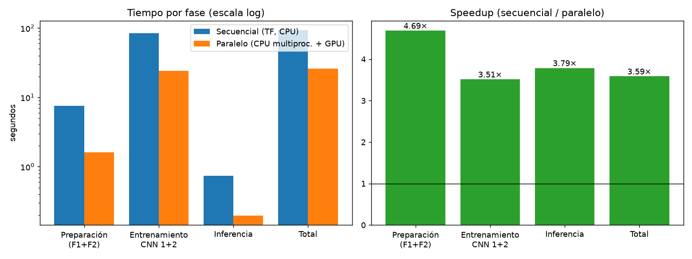

# 6. Análisis y conclusiones

Todas las cifras provienen de las mediciones del repositorio (`secuencial/resultados/`, `gpu/resultados/`) y están consolidadas en `docs/tablas_comparacion.md`. Mismo equipo, mismos datos, misma semilla, 10 épocas fijas, 5 corridas medidas y 1 de calentamiento descartada en cada configuración.

## 6.1 Comparación de tiempos (media ± desviación, segundos)

| Fase | Secuencial (TensorFlow, CPU) | Paralelo (CPU multiproceso + GPU) | Speedup |
|---|---|---|---|
| F1 Listado + split + submuestreo (sin cambios) | 0.68 ± 0.14 | 0.62 ± 0.03 | 1.09× |
| F2 Preprocesamiento de imágenes (train + val) | 6.89 ± 2.36 | 0.99 ± 0.01 | **6.95×** |
| T Transferencia CPU→GPU + normalización en GPU | — | 0.019 ± 0.003 | — (costo nuevo) |
| F3 Entrenamiento CNN 1 (10 épocas) | 38.93 ± 3.55 | 11.37 ± 0.08 | **3.42×** |
| F3 Entrenamiento CNN 2 (10 épocas) | 45.89 ± 3.63 | 12.76 ± 0.07 | **3.60×** |
| F5 Inferencia en validación (CNN 1 + 2), PyTorch/cuDNN | 0.74 | 0.195 | 3.79× |
| F5 Inferencia con kernels propios (Numba CUDA) | 0.74 | 0.362 | 2.04× |
| **Total del pipeline de CNN (sin Random Forest)** | **93.13 ± 9.71** | **25.96 ± 0.12** | **3.59×** |

| Agrupación | Secuencial (s) | Paralelo (s) | Speedup |
|---|---|---|---|
| Preparación de datos (F1 + F2) | 7.57 | 1.62 | 4.69× |
| Entrenamiento (CNN 1 + CNN 2) | 84.82 | 24.13 | 3.51× |
| Total | 93.13 | 25.96 | **3.59×** |

### Por época y contra PyTorch en CPU (para separar framework de dispositivo)

| Por época | TensorFlow CPU (secuencial) | PyTorch CPU | PyTorch GPU | Speedup GPU vs línea base | Speedup GPU vs PyTorch CPU |
|---|---|---|---|---|---|
| CNN 1 | 3.89 s | 6.99 s | 1.14 s | 3.42× | 6.15× |
| CNN 2 | 4.59 s | 9.24 s | 1.28 s | 3.60× | 7.24× |

### Speedup por corrida

| Corrida | Secuencial (s) | Paralelo (s) | Speedup |
|---|---|---|---|
| 1 | 110.47 | 25.78 | 4.29× |
| 2 | 88.98 | 25.91 | 3.43× |
| 3 | 88.45 | 26.04 | 3.40× |
| 4 | 88.18 | 25.99 | 3.39× |
| 5 | 89.58 | 26.10 | 3.43× |

La corrida 1 del secuencial fue ≈ 20 % más lenta que las demás y eleva la media. **El speedup típico es ≈ 3.4×** (mediana 3.43×; media de las corridas 2–5: 3.41×), y la media de las 5 es 3.59×. Conviene citar el rango **3.4–3.6×**.

### Speedup incluyendo el Random Forest

El Random Forest (12.77 s) no se migra y queda igual en ambas versiones (ya usa los 16 núcleos). Si se incluye en el total: 105.90 s → 38.73 s, speedup **2.73×**.

### Precisión del modelo (accuracy en validación, 10 épocas)

| Modelo | TensorFlow CPU | PyTorch GPU (media ± desv.) | PyTorch CPU |
|---|---|---|---|
| CNN 1 | 0.9226 | 0.9066 ± 0.0147 | 0.9046 |
| CNN 2 | 0.9667 | 0.9701 ± 0.0053 | 0.9625 |

La aceleración no degrada el modelo de forma sistemática; las diferencias están dentro de la variabilidad entre corridas y entre frameworks. Los kernels propios de inferencia dan exactamente las mismas predicciones que PyTorch.

## 6.2 ¿Se redujeron los tiempos?

Sí. El pipeline pasó de ≈ 93 s a ≈ 26 s (**3.4–3.6×**). Extrapolado a la configuración original del notebook (CNN 1 con 17 épocas y CNN 2 con 30, con EarlyStopping), el entrenamiento pasaría de ≈ 204 s a ≈ 58 s, un speedup parecido (≈ 3.5×).

## 6.3 Contraste con lo predicho en la sección 3 (ley de Amdahl)

La sección 3 estimaba que si la GPU aceleraba el entrenamiento ×5, el pipeline total llegaría a ≈ 3.8×. Se midió **3.51× en entrenamiento y 3.59× en total**, coherente con esa estimación para un factor de aceleración ≈ 3.5. La preparación de datos, que era la fracción que limitaba el techo, bajó de 7.6 s a 1.6 s, y el tiempo restante está dominado por el entrenamiento (24.1 de 26.0 s, 93 %). Del tiempo paralelo que queda, **solo ≈ 6 % es CPU**: ya no hay mucho más que ganar paralelizando la preparación.

## 6.4 Posibles causas de las diferencias de rendimiento

**Por qué la GPU gana en el entrenamiento (3.5×)**
- Convoluciones y multiplicaciones de matrices son cómputo denso, regular e independiente entre elementos de salida; la GPU lo ejecuta con miles de hilos. La utilización de GPU medida fue de 95–99 %.
- Datos y pesos viven en la memoria de la GPU durante todo el entrenamiento: el costo de transferencia es de 0.019 s (≈ 0.02 % del total).
- cuDNN y cuBLAS están muy optimizados para estas operaciones.

**Por qué no es mucho mayor**
- **La línea base ya es fuerte:** TensorFlow usa 15 de 16 hilos lógicos del CPU (oneDNN), con ≈ 70 % de uso promedio. No se compara contra un CPU de un solo núcleo, y por eso el speedup es de 3.5× y no de decenas de veces. Contra PyTorch en CPU (peor optimizado en este equipo) el speedup sería 6–7×, pero esa no es la solución original.
- **Problema pequeño:** imágenes de 64×64, lote 32 y ≈ 1.3–1.6 M parámetros. Un paso de entrenamiento dura ≈ 3 ms en GPU, y una parte importante es sobrecarga de lanzamiento de kernels y de Python (381 pasos por época, cada uno con decenas de kernels). La GPU está "ocupada" (95–99 %) pero con kernels cortos y de poco trabajo cada uno.
- **El lote 32 limita el paralelismo disponible:** lotes mayores aprovecharían mejor la GPU, pero cambiarían la dinámica del entrenamiento y no se modificaron para mantener la comparación equivalente.
- **GPU de portátil** (RTX 5060 Laptop, ≈ 60 W en entrenamiento, según `nvidia-smi`).
- **Los pasos sucesivos son secuenciales** por dependencia de pesos, de modo que no se puede paralelizar entre pasos.

**Por qué el preprocesamiento sí mejora mucho (6.95×)**
- Es embarazosamente paralelo (cada imagen es independiente). Con 16 procesos, 12.8 núcleos superaron el 50 % de uso.
- Se limita a ≈ 5× en el escalamiento aislado (sección 5) por arranque del pool, disco y mezcla de núcleos de distinto rendimiento. El 6.95× frente al secuencial del benchmark incluye además que la corrida secuencial medida fue más lenta (media 6.89 s con una corrida atípica de 11.1 s; sin ella ≈ 5.7 s, que daría ≈ 5.7×).

**Kernels propios**
- Producen resultados correctos, pero son 1.9× más lentos que cuDNN en la inferencia: convolución directa, sin *tiling* de la entrada ni fusión avanzada. Aun así son 2× más rápidos que TensorFlow en CPU.

## 6.5 Discusión técnica (preguntas del informe)

### ¿Por qué es más eficiente procesar las imágenes/archivos con los múltiples núcleos del CPU y delegar exclusivamente la matemática de la red neuronal al GPU?

- **La naturaleza del trabajo es distinta.** Preparar imágenes es leer archivos del disco y decodificar JPEG: E/S más lógica con muchas ramas (decodificación de Huffman, longitud variable) y poco cómputo aritmético por byte. Los núcleos del CPU son buenos en ese control de flujo irregular y acceden directamente al sistema de archivos. La GPU no puede leer archivos ni decodificar JPEG de forma eficiente con kernels generales.
- **Mandar los JPG a la GPU no ahorra nada,** porque habría que decodificarlos en CPU de todos modos. En cambio, entregar tensores `uint8` ya preparados reduce 4× la transferencia, y la conversión elemento a elemento (`/255`, reordenamiento NCHW) sí se hace en GPU (0.0075 s).
- **La red neuronal es lo contrario:** cómputo denso, regular e independiente entre elementos de salida, con alta intensidad aritmética, que es exactamente lo que ejecutan miles de núcleos CUDA. Medido: el entrenamiento representa el 93 % del tiempo paralelo y satura la GPU al 95–99 %.
- **Resultado medido de la separación:** el CPU pasó de 2 núcleos activos (secuencial) a 12.8 en la preparación, y en entrenamiento el CPU queda casi ocioso (≈ 10 %) mientras la GPU trabaja al 96 %. Cada tipo de unidad se usa en lo que hace mejor.
- Con `uint8` como formato intermedio, la transferencia es de una sola vez y cuesta 0.012 s.

### ¿Cómo CUDA permitió reducir o cambiar el tiempo de procesamiento?

- Convirtió el cómputo del paso de entrenamiento de *decenas de millones de operaciones por lote ejecutadas en 16 hilos de CPU* a *decenas de millones de hilos ligeros* (por ejemplo, 33.5 millones de hilos en la primera convolución de un lote de 256, sección 4).
- El entrenamiento pasó de 84.8 s a 24.1 s (3.5×) y la inferencia de 0.74 s a 0.195 s (3.8×).
- El cuello de botella **sigue siendo el entrenamiento** (80 % del total antes, 93 % ahora), pero 3.5 veces más corto, y como la preparación de datos bajó a 1.6 s, el entrenamiento pesa proporcionalmente más.
- Cambió la **forma de uso de recursos**: el CPU queda libre durante el entrenamiento (≈ 10 %), lo que permitiría solapar la preparación de nuevos datos con el entrenamiento en una mejora futura.
- El Random Forest, que no tiene versión CUDA, pasó a ser el 33 % del tiempo total si se incluye (12.8 s de 38.7 s), lo que ilustra cómo lo no migrado pasa a dominar.

### ¿Qué factores justifican o limitan la utilización de CUDA?

**Justifican:**
- Cómputo denso, regular y masivamente paralelo (convoluciones, GEMM).
- Datos que caben en memoria de GPU y se reutilizan (8 GB disponibles; el dataset usa < 1 GB).
- Entrenamientos largos que repiten el mismo cálculo muchas veces (aquí 381 pasos × 10 épocas × 2 modelos), que amortizan el costo fijo de inicialización.
- Posibilidad de escalar: más datos, resolución mayor (200×200), lotes más grandes o modelos más profundos aumentarían la ventaja de la GPU.

**Limitan:**
- **Costos fijos y transferencia:** inicialización de CUDA, compilación JIT de kernels (se descarta en el calentamiento), copia CPU↔GPU. Aquí fue pequeña (0.019 s) porque se transfiere una sola vez.
- **Tamaño del problema:** 64×64 y lote 32 dejan poco trabajo por kernel; la sobrecarga de lanzamiento y de Python se vuelve visible.
- **La línea base ya usa todos los núcleos del CPU,** lo que reduce la ventaja.
- **Partes no paralelizables o no migrables:** dependencia secuencial entre pasos de entrenamiento, E/S de disco, decodificación JPEG, Random Forest.
- **Ley de Amdahl:** la fracción que queda en CPU fija el techo.
- **Complejidad del desarrollo y del entorno:** versiones de CUDA, controladores, compatibilidad con la arquitectura de la GPU (Blackwell necesitó CUDA 12.8 o superior), TensorFlow sin soporte de GPU en Windows nativo, y dependencias (NumPy con `numba-cuda`).
- **No determinismo:** el entrenamiento en GPU no es reproducible bit a bit (variación de accuracy de CNN 1 entre 0.893 y 0.930).
- **Memoria de GPU limitada** (8 GB) y consumo energético en un portátil.

## 6.6 Conclusiones

1. La paralelización redujo el tiempo del pipeline de CNN de ≈ 93 s a ≈ 26 s, un **speedup de 3.4–3.6×** (2.7× si se cuenta el Random Forest, que no se migró).
2. **Speedup por fase:** preprocesamiento ≈ 7× (CPU multiproceso, 16 procesos), entrenamiento ≈ 3.5× (GPU), inferencia ≈ 3.8× (cuDNN) o ≈ 2× (kernels propios).
3. La separación **CPU para preparar datos / GPU para la matemática de la red** está respaldada por las mediciones de uso de recursos: 12.8 núcleos activos en la preparación, GPU al 95–99 % en el entrenamiento.
4. Los kernels CUDA propios (Numba) son **correctos** (mismas predicciones que PyTorch en todas las pruebas) pero **más lentos que cuDNN** (1.9×).
5. La ganancia no es de órdenes de magnitud porque el modelo y las imágenes son pequeños y porque TensorFlow ya aprovechaba los 16 hilos del CPU. Con imágenes de mayor resolución, lotes mayores o redes más profundas, la ventaja de la GPU debería crecer.

## 6.7 Limitaciones y trabajo futuro

- Los resultados corresponden a **un solo equipo** (portátil con RTX 5060 y 16 hilos lógicos); no se pueden extrapolar a otros.
- Se midieron 10 épocas fijas, no el entrenamiento completo con EarlyStopping (se extrapola).
- No se entrenaron las redes densas ni los modelos con aumento de datos con CUDA, ni se migró el Random Forest.
- Los kernels propios cubren la propagación hacia adelante; la retropropagación usa PyTorch.
- Mejoras posibles: solapar la preparación de datos con el entrenamiento (cola de lotes con hilos), probar lotes mayores, precisión mixta (FP16/AMP), `torch.compile` o CUDA Graphs para reducir la sobrecarga de lanzamiento, optimizar la convolución propia con *tiling*, y reproducir la medición en otra GPU.
- Pendiente para el informe final: capturas de pantalla del Administrador de Tareas y de `nvidia-smi` en vivo.
